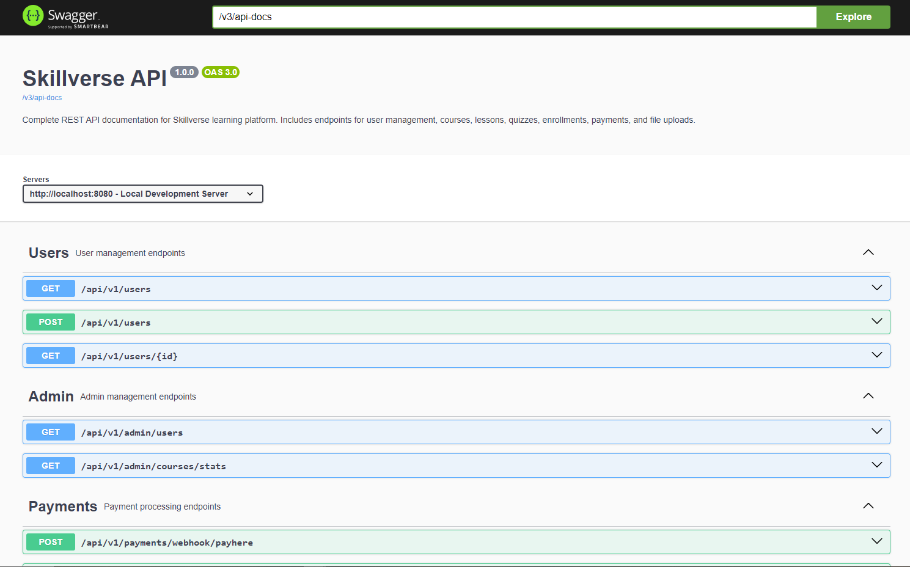
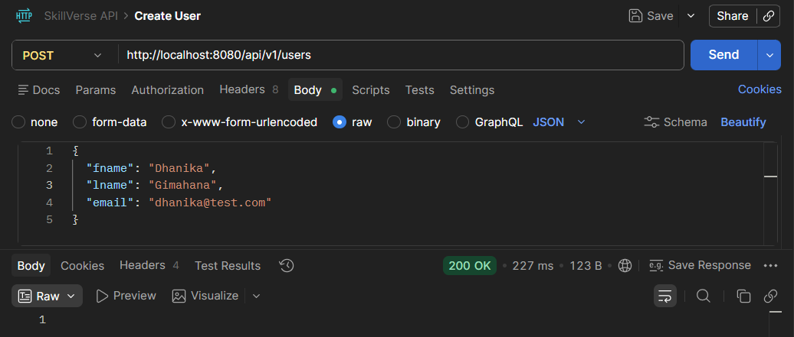
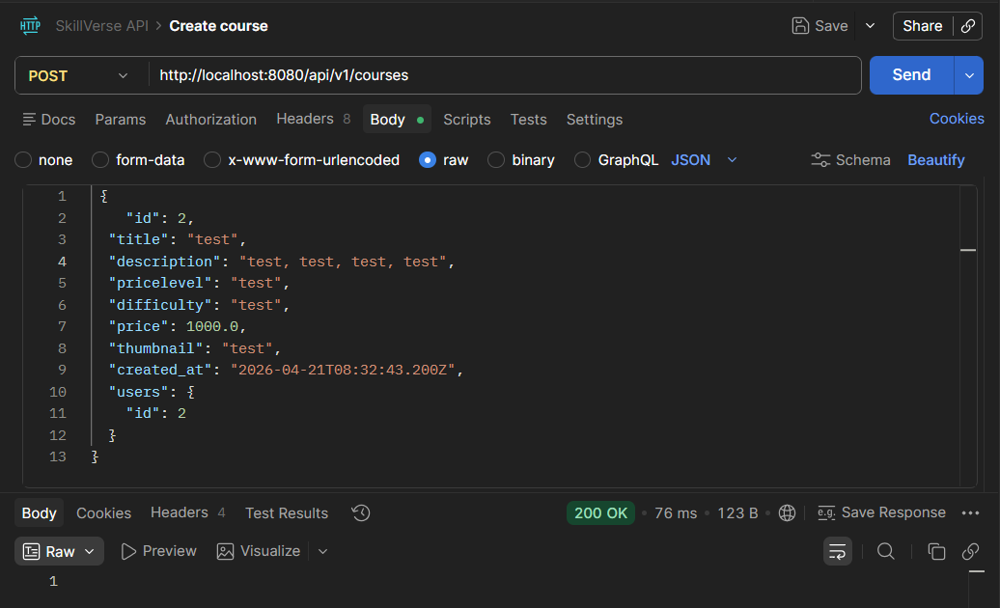
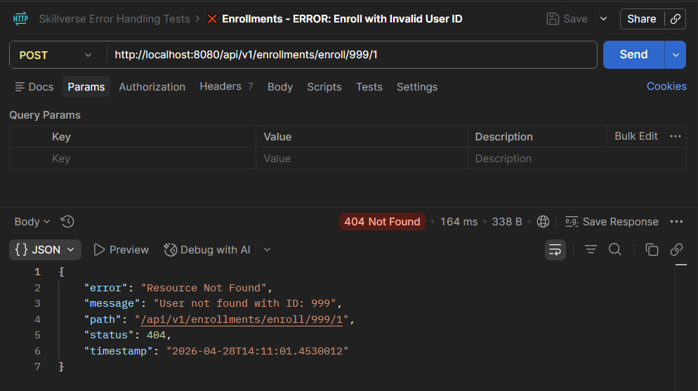
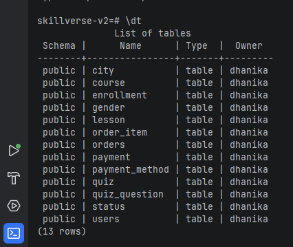
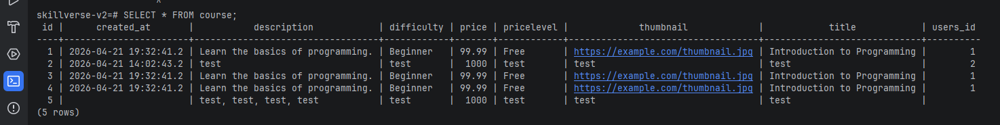

# SkillVerse 2.0 - Backend API

REST API for **SkillVerse**, an online learning platform. Built with Spring Boot as a hands-on project to practise layered architecture, JWT security, relational modelling and third-party integrations (Cloudinary, PayHere).

[](LICENSE)


| | |
|---|---|
| **Frontend** | [DhanikaJ/skillverse-ui](https://github.com/DhanikaJ/skillverse-ui) · [live demo](https://skillverse-ui.vercel.app/) |
| **Status** | Sandbox / learning project |
| **API base path** | `/api/v1` (default port `8080`) |

### Try the live demo

Open the [live demo](https://skillverse-ui.vercel.app/login) and use the **Demo accounts** panel on the login page, or sign in manually:

| Role | Email | What you can do |
|---|---|---|
| Student | `demo.student@example.com` | Browse courses, enrol, open **My Courses** with progress already recorded |
| Instructor | `demo.instructor@example.com` | Owns four courses with lessons and quizzes; can create courses and lessons |
| Administrator | `demo.admin@example.com` | Read-only view of users, payments, orders and statistics |

Password for all three: `Demo@2026`

These are public sandbox accounts holding generated sample data only. The administrator is read-only and file uploads are disabled for demo accounts. See [Demo mode](#demo-mode-sandbox-showcase).

---

## Table of contents

1. [Features](#features)
2. [Tech stack](#tech-stack)
3. [Architecture](#architecture)
4. [Screenshots](#screenshots)
5. [API reference](#api-reference)
6. [Getting started](#getting-started)
7. [Configuration](#configuration)
8. [Security model](#security-model)
9. [Design decisions](#design-decisions)
10. [Deployment](#deployment)
11. [Testing](#testing)
12. [Project structure](#project-structure)
13. [Roadmap](#roadmap)
14. [License](#license)

---

## Features

**Implemented**

- **Authentication** - registration and login return a signed JWT; `GET /auth/me` resolves the current user. Passwords are stored with BCrypt.
- **Roles and ownership** - `STUDENT`, `INSTRUCTOR`, `ADMIN`, enforced with method-level security and per-resource ownership checks.
- **Courses** - paginated listing, detail lookup and creation, with Bean Validation on request bodies.
- **Enrollment** - enrol the current user, list "my" enrollments, list by user or by course; duplicate enrollment is rejected.
- **Lessons** - full CRUD nested under a course.
- **Quizzes** - create quizzes and fetch their questions.
- **Orders and payments** - order and order-item records, payments priced from the course, and a signature-verified PayHere notification endpoint that enrols the learner when a payment succeeds.
- **File upload** - multipart upload to Cloudinary, 10 MB limit.
- **Admin** - user listing and course/enrollment statistics.
- **Centralised error handling** - `GlobalExceptionHandler` maps validation, not-found and state errors to an `ErrorResponse` shape.
- **API docs** - OpenAPI 3 / Swagger UI (development and test profiles).
- **Seed data** - sample users, courses and enrollments for development and tests (never in production).

**Modelled, endpoints not yet exposed:** cart, certificates, reviews, quiz attempts.

---

## Tech stack

| Layer | Technology |
|---|---|
| Language / runtime | Java 17 |
| Framework | Spring Boot 3.2.5 (Web, Data JPA, Security, Validation) |
| Database | PostgreSQL (H2 in-memory for the `test` profile) |
| ORM | Hibernate / Spring Data JPA |
| Security | Spring Security, JWT (jjwt 0.11.5, HS256), BCrypt |
| API docs | springdoc-openapi 2.5.0 |
| File storage | Cloudinary |
| Payments | PayHere (sandbox-oriented integration) |
| Config | `.env` loading via java-dotenv, Spring profiles |
| Build | Maven Wrapper |
| Containers | Docker Compose (local PostgreSQL) |
| Hosting | Railway (API), Vercel (UI) |

---

## Architecture

```text
 React UI (Vercel)
        │  HTTPS + JSON, Authorization: Bearer <JWT>
        ▼
 ┌──────────────────────────────────────────────────────────┐
 │ Spring Security filter chain                             │
 │   CORS → JwtAuthFilter → method security (@PreAuthorize) │
 └───────────────┬──────────────────────────────────────────┘
                 ▼
         Controllers  ── DTOs / EntityMapper ──┐
                 ▼                             │
          Services (@Transactional)            │  GlobalExceptionHandler
                 ▼                             │  → ErrorResponse
       Spring Data repositories ◄──────────────┘
                 ▼
            PostgreSQL            Cloudinary (uploads)   PayHere (webhooks)
```

Packages follow the layers: `controller` → `service` → `repository` → `model`, with `dto` and `mapper` isolating the API contract from the entities, and `config`, `security` and `exception` for cross-cutting concerns.

---

## Screenshots

**Swagger UI**



**Postman**





**Database (PostgreSQL)**




---

## API reference

Base URL: `http://localhost:8080/api/v1`. Interactive docs are served at `/swagger-ui.html` when the `dev` profile is active.

**Access legend:** *Public* = no token · *Auth* = any valid JWT · *Role* = JWT with the listed role.

### Auth

| Method | Path | Description | Access |
|---|---|---|---|
| `POST` | `/auth/register` | Create a `STUDENT` account, returns a JWT | Public |
| `POST` | `/auth/login` | Authenticate, returns a JWT | Public |
| `GET` | `/auth/me` | Current user profile | Auth |
| `GET` | `/auth/demo-accounts` | Public demo credentials (empty unless demo mode is on) | Public |

Request body for register/login: `{ "email": "…", "password": "…" }`
Response: `{ "success": true, "message": "…", "token": "…", "type": "Bearer", "email": "…", "role": "STUDENT" }`

### Courses

| Method | Path | Description | Access |
|---|---|---|---|
| `GET` | `/courses?page=0&size=10` | Paginated course list | `STUDENT`, `INSTRUCTOR`, `ADMIN` |
| `GET` | `/courses/{id}` | Course detail | `STUDENT`, `INSTRUCTOR`, `ADMIN` |
| `POST` | `/courses` | Create a course (the caller becomes its instructor) | `INSTRUCTOR`, `ADMIN` |

### Enrollments

| Method | Path | Description | Access |
|---|---|---|---|
| `POST` | `/enroll/{courseId}` | Enrol the current user (see [Enrollment policy](#enrollment-policy)) | Auth |
| `GET` | `/users/me/enrollments` | Current user's enrollments | Auth |
| `POST` | `/enrollments/enroll/{studentId}/{courseId}` | Enrol a given student | `ADMIN` |
| `GET` | `/enrollments/user/{userId}` | Enrollments for a user | That user or `ADMIN` |
| `GET` | `/enrollments/course/{courseId}` | Enrollments for a course | Course instructor or `ADMIN` |

### Lessons

| Method | Path | Description | Access |
|---|---|---|---|
| `POST` | `/courses/{courseId}/lessons` | Add a lesson | Course instructor or `ADMIN` |
| `GET` | `/courses/{courseId}/lessons` | List lessons | Enrolled learner, course instructor or `ADMIN` |
| `GET` | `/courses/{courseId}/lessons/{lessonId}` | Lesson detail | Enrolled learner, course instructor or `ADMIN` |
| `PUT` | `/courses/{courseId}/lessons/{lessonId}` | Update a lesson | Course instructor or `ADMIN` |
| `DELETE` | `/courses/{courseId}/lessons/{lessonId}` | Delete a lesson | Course instructor or `ADMIN` |

### Quizzes

| Method | Path | Description | Access |
|---|---|---|---|
| `POST` | `/quizzes` | Create a quiz for a course | Course instructor or `ADMIN` |
| `GET` | `/quizzes/{id}/questions` | Questions for a quiz | Enrolled learner, course instructor or `ADMIN` |

### Orders and payments

| Method | Path | Description | Access |
|---|---|---|---|
| `POST` | `/orders` | Create an order for the caller (`?userId=` is honoured for admins only) | Auth |
| `POST` | `/orders/{orderId}/items?courseId=` | Add a course to a pending order; price is the course price | Order owner or `ADMIN` |
| `GET` | `/orders/{orderId}` | Order detail | Order owner or `ADMIN` |
| `GET` | `/orders/user/{userId}` | Orders of a user | That user or `ADMIN` |
| `GET` | `/orders?status=` | All orders | `ADMIN` |
| `PUT` | `/orders/{orderId}?status=` | Update order status | `ADMIN` |
| `POST` | `/payments/initiate` | Start a payment: body `{ "courseId", "paymentMethod" }`; payer from JWT, amount from course | Auth |
| `POST` | `/payments/webhook/payhere` | PayHere notification (`application/x-www-form-urlencoded`); alias `/payments/webhook/payhere-detailed` | Public, authenticated by `md5sig` |
| `GET` | `/payments/{id}` · `/payments/txn/{ref}` | Read one payment | Payment owner or `ADMIN` |
| `GET` | `/payments/user/{userId}` | Payments of a user | That user or `ADMIN` |
| `GET` | `/payments` | All payments | `ADMIN` |

### Users, admin, files, health

| Method | Path | Description | Access |
|---|---|---|---|
| `GET` | `/users/{id}` | User by ID | That user or `ADMIN` |
| `POST` | `/users` | Create a user record | `ADMIN` |
| `GET` | `/users/admin/users?page=0&size=10` | Paginated users | `ADMIN` |
| `GET` | `/admin/users` | All users | `ADMIN` |
| `GET` | `/admin/courses/stats` | Course and enrollment totals | `ADMIN` |
| `POST` | `/upload` | Multipart upload (`file`: image, video or PDF) → Cloudinary URL | `INSTRUCTOR`, `ADMIN` |
| `GET` | `/` · `/hello` *(outside `/api/v1`)* | Health check | Public |

### Error format

```json
{
  "error": "Not Found",
  "status": 404,
  "message": "Course not found with ID: 42",
  "timestamp": "2026-01-01T10:00:00",
  "path": "/api/v1/courses/42"
}
```

---

## Getting started

### Prerequisites

- JDK 17
- Docker (for the local PostgreSQL container) - or any PostgreSQL 14+ instance
- Optional: a Cloudinary account (only needed to exercise `/upload`)

### Run locally

```bash
git clone https://github.com/DhanikaJ/skillverse-v2.git
cd skillverse-v2
```

Create a `.env` file in the project root. Docker Compose and the `dev` profile both read these values, so one password covers the container and the app:

```env
POSTGRES_USER=skillverse
POSTGRES_PASSWORD=choose-a-local-password
POSTGRES_DB=skillverse-v2
```

The full list of supported variables (JWT, Cloudinary, CORS, production database) is in [Configuration](#configuration).

Start PostgreSQL (published on host port **5332**):

```bash
docker compose up -d
```

Run the API with the `dev` profile:

```bash
SPRING_PROFILES_ACTIVE=dev ./mvnw spring-boot:run
```

On Windows PowerShell:

```powershell
$env:SPRING_PROFILES_ACTIVE = "dev"; .\mvnw.cmd spring-boot:run
```

The API is now at `http://localhost:8080` and Swagger UI at `http://localhost:8080/swagger-ui.html`.

### Try it

```bash
# register
curl -X POST http://localhost:8080/api/v1/auth/register \
  -H "Content-Type: application/json" \
  -d '{"email":"you@example.com","password":"a-strong-password"}'

# use the returned token
curl http://localhost:8080/api/v1/courses \
  -H "Authorization: Bearer <token>"
```

### Seed data (development and test only)

With the `dev` or `test` profile, `DataSeeder` inserts sample users, courses and enrollments if they do not already exist:

| Role | Accounts |
|---|---|
| `ADMIN` | `admin@example.com` |
| `INSTRUCTOR` | `instructor@example.com`, `dr.smith@skillverse.com`, `prof.jones@skillverse.com` |
| `STUDENT` | `student@example.com`, `alice.student@example.com`, `bob.tester@example.com`, `charlie.learner@example.com` |

All sample accounts share the password in `SEED_PASSWORD` (default `password123` in the `dev` and `test` profiles only). Set `SEED_PASSWORD` in `.env` to use your own.

**Seeding never runs in the default or `prod` profile.** Only the payment-method reference data is created in every environment.

### Demo mode (sandbox showcase)

Demo mode turns the deployment into a recruiter-friendly showcase. It is **off by default**; enable it with `DEMO_MODE=true` in any profile, including `prod`.

What it does:

- Creates three demo accounts (student, instructor, administrator) that share one **public** password (`DEMO_PASSWORD`, default `Demo@2026`). The password is rotated into the stored hash on every start if you change it.
- Seeds a realistic catalogue: eight courses (one free) across four instructors, four lessons per course, three quizzes, fifteen learner enrollments with varying progress, and the matching orders and payments. The demo student is enrolled in three courses and the rest stay open so the enrol flow can be tried.
- Supporting instructors and learners are locked accounts: they own data but cannot sign in.
- Publishes the credentials at `GET /api/v1/auth/demo-accounts` so the UI can show one-click demo sign-in.
- Seeding is idempotent; restarting never duplicates data.

Because the password is public, demo accounts are limited: the demo administrator is read-only (every non-`GET` request is rejected with `403`), and demo accounts cannot upload files. The demo instructor can still create courses and lessons, so occasionally clear test content from the database.

```bash
DEMO_MODE=true SPRING_PROFILES_ACTIVE=dev ./mvnw spring-boot:run
```

#### Self-contained demo deployment (free hosting)

The `demo` profile needs no database, JWT secret or Cloudinary account, so it runs on any free container host. Everything is seeded in memory at start-up and resets on restart, which suits a showcase.

```bash
SPRING_PROFILES_ACTIVE=demo ./mvnw spring-boot:run

# or with Docker (the image defaults to the demo profile)
docker build -t skillverse-demo .
docker run -p 8080:8080 -e CORS_ALLOWED_ORIGINS=https://your-ui.example skillverse-demo
```

| Variable | Needed | Purpose |
|---|---|---|
| `CORS_ALLOWED_ORIGINS` | yes | Origin(s) of the deployed UI, comma-separated, no trailing slash |
| `JWT_SECRET` | no | Keeps tokens valid across restarts; a random key is used if unset |
| `DEMO_PASSWORD` | no | Shared demo password (default `Demo@2026`) |
| `PORT` | set by the host | HTTP port |

`render.yaml` is a ready-made [Render](https://render.com) blueprint (free plan). Free services sleep when idle, so the first request after a quiet period can take up to a minute; the login page shows a "connecting" notice and retries automatically. The process uses roughly 300 MB, which fits a 512 MB free tier. Point the UI's `VITE_API_BASE_URL` at `https://<host>/api/v1` and redeploy it, since Vite bakes the value in at build time.

### Connect the frontend

In `skillverse-ui`, set:

```env
VITE_API_BASE_URL=http://localhost:8080/api/v1
```

Add the UI origin (default `http://localhost:5173`) to the backend CORS configuration - see [Configuration](#configuration).

---

## Configuration

Configuration is read from environment variables (or a local `.env`, which is git-ignored).

| Variable | Used in | Required | Description |
|---|---|---|---|
| `SPRING_PROFILES_ACTIVE` | all | yes (`dev` locally, `prod` when deployed) | Selects the property file |
| `DATABASE_URL` | default, `dev` | no | JDBC URL. Default `jdbc:postgresql://localhost:5332/skillverse-v2` |
| `DB_USERNAME`, `DB_PASSWORD` | default, `dev` | yes | `dev` falls back to `POSTGRES_USER` / `POSTGRES_PASSWORD` |
| `POSTGRES_USER`, `POSTGRES_PASSWORD`, `POSTGRES_DB` | Docker Compose, `dev` | yes (password) | Credentials for the local container |
| `PGHOST`, `PGPORT`, `PGDATABASE`, `PGUSER`, `PGPASSWORD` | `prod` | yes | Supplied by the managed PostgreSQL service |
| `JWT_SECRET` | all | yes (`prod`) | Signing key, at least 32 random bytes |
| `JWT_EXPIRATION` | all | yes (`prod`) | Token lifetime in milliseconds (`86400000` = 24 h) |
| `CLOUDINARY_CLOUD_NAME`, `CLOUDINARY_API_KEY`, `CLOUDINARY_API_SECRET` | all | for uploads | Cloudinary credentials |
| `PORT` | `prod` | no | HTTP port, default `8080` |
| `PAYHERE_MERCHANT_ID`, `PAYHERE_MERCHANT_SECRET` | all | for payments | Used to verify PayHere notifications. If blank, every notification is rejected |
| `ENROLLMENT_REQUIRE_PAYMENT` | all | no | `true` = paid courses need a successful payment before enrolment. Default `false` |
| `SEED_PASSWORD` | `dev`, `test` | no | Password for seeded sample accounts. Default `password123` |
| `DEMO_MODE` | all | no | `true` seeds the public demo accounts and data and publishes their credentials. Default `false` |
| `DEMO_PASSWORD` | all | no | Shared password of the three demo accounts. Public by design. Default `Demo@2026` |
| `CORS_ALLOWED_ORIGINS` | property files | no | Comma-separated UI origins |

Generate a JWT secret:

```bash
openssl rand -base64 48
```

**Profiles**

| Profile | Database | Swagger | Notes |
|---|---|---|---|
| *(default)* | PostgreSQL | off | Requires `DB_PASSWORD`, `JWT_SECRET`, Cloudinary variables |
| `dev` | PostgreSQL | on | SQL logging, development defaults |
| `test` | H2 in-memory | on | `create-drop` schema |
| `prod` | PostgreSQL via `PG*` | off | Quiet logging, JDBC batching |
| `demo` | H2 in-memory | off | Self-contained showcase: demo mode always on, data re-seeded and reset on every start, no external services |

> **CORS:** allowed origins are currently defined in `config/CorsConfig.java` (`/api/v1/**`). Add your local UI origin there for development. Binding this to `CORS_ALLOWED_ORIGINS` is on the roadmap.

---

## Security model

What is in place:

- Stateless sessions; JWT verified on every request by `JwtAuthFilter`.
- BCrypt password hashing; secrets supplied through environment variables and excluded from version control.
- Role-based method security (`@PreAuthorize`) plus object-level rules in `AccessPolicy`: users reach only their own orders, payments, enrollments and profile; instructors manage only their own courses, lessons and quizzes; lesson and quiz content requires enrollment; administrators have full access. Denials return `403` with a JSON `ErrorResponse`.
- The acting user always comes from the JWT, never from request parameters.
- **Server-side pricing:** payment amounts and order-item prices are taken from the course; client-supplied amounts are ignored.
- **PayHere notifications** are public (the provider sends no JWT) but must carry a valid `md5sig` computed with the merchant secret. Checks: signature and merchant ID, known `order_id`, amount equals the stored payment amount. Handling is idempotent — a payment that already succeeded is never changed or enrolled twice. With no merchant credentials configured, all notifications are rejected.
- Sample accounts are created only in the `dev` and `test` profiles. The separate, opt-in [demo mode](#demo-mode-sandbox-showcase) exposes three public accounts with limits (read-only administrator, no uploads).
- `password_hash` and verification tokens are never serialized.
- Bean Validation on request DTOs; JPA parameter binding (no string-built SQL).
- Swagger/OpenAPI disabled outside `dev` and `test`.

### Enrollment policy

`POST /enroll/{courseId}` lets any authenticated user join a course directly, which keeps the sandbox demo usable without a payment account. Set `ENROLLMENT_REQUIRE_PAYMENT=true` to require a successful payment for any course with a price above zero.

### Still planned

This is a learning project, and some areas remain scoped down:

- Rate limiting, uniform authentication error responses and password rules.
- Lesson and quiz endpoints still return entities rather than DTOs.
- Monetary values use `double` rather than `BigDecimal`.
- PayHere currency is not checked, and the integration has been exercised only against locally computed signatures, not the PayHere sandbox.

---

## Design decisions

| Decision | Rationale |
|---|---|
| **Stateless JWT** instead of server sessions | Fits a separately hosted SPA and keeps the API horizontally scalable. |
| **DTO + mapper layer** between controllers and entities | Keeps the API contract stable, avoids lazy-loading and serialization problems, and prevents accidental exposure of entity fields. Applied to users, courses, enrollments, orders and payments; lessons and quizzes are next. |
| **Service layer with `@Transactional` boundaries** | Business rules and transaction handling live outside the controllers. |
| **Method-level security (`@PreAuthorize`)** on top of a URL-level default | Authorization rules sit beside the code they protect. |
| **Spring profiles for environments** | One codebase with distinct database, logging and documentation behaviour for dev, test and prod. |
| **Externalised configuration** | Secrets and environment-specific values are injected at runtime; `.env.example` documents what is required. |
| **Central exception handler with a typed error body** | Predictable error handling for the client. |
| **Provider-hosted media (Cloudinary)** | Keeps binary storage out of the application and database. |
| **Separate UI and API deployments** | Independent release cycles; CORS restricted to known origins. |
| **OpenAPI generated from code** | Documentation stays in step with controllers. |

---

## Deployment

The API is configured for a container/PaaS host (Railway) with a managed PostgreSQL instance; the UI is deployed on Vercel.

1. Provision PostgreSQL and expose `PGHOST`, `PGPORT`, `PGDATABASE`, `PGUSER`, `PGPASSWORD`.
2. Set `SPRING_PROFILES_ACTIVE=prod`, `JWT_SECRET`, `JWT_EXPIRATION`, and the `CLOUDINARY_*` variables.
3. Build and run:
   ```bash
   ./mvnw clean package -DskipTests
   java -jar target/skillverse-v2-0.0.1-SNAPSHOT.jar
   ```
4. Point the UI's `VITE_API_BASE_URL` at `https://<api-host>/api/v1` and make sure the UI origin is allowed by CORS.

> The schema is managed with Hibernate `ddl-auto=update`. `recreate-tables.sql` drops every table - use it only on a disposable development database.

---

## Testing

```bash
./mvnw test
```

Tests run against the `test` profile (in-memory H2) with the seeded accounts and need no external services.

| Test class | Covers |
|---|---|
| `SecurityHardeningIntegrationTest` | Role and ownership rules, server-side pricing, lesson access, PayHere notification handling (invalid signature, wrong amount, success, duplicate/downgrade) |
| `DemoModeIntegrationTest` | Published demo credentials, seeded showcase data, read-only demo administrator, upload block, idempotent seeding |
| `DemoProfileSmokeTest` | The `demo` profile boots with no environment variables, serves working demo accounts, and returns 4xx rather than 500 for client mistakes |
| `DemoControllerTest` | Nothing is published while demo mode is off |
| `PayHereSignatureServiceTest` | `md5sig` verification and fail-closed behaviour |
| `EnrollmentPaymentRuleTest` | Payment-required enrollment rule; seeder restricted to `dev`/`test` |
| `SkillverseV2ApplicationTests` | Application context loads |

PowerShell scripts in the repository root (`test-api.ps1`, `test-all-endpoints.ps1`, …) were written for the pre-authentication API and need a JWT to be useful now.

Planned: tests for the remaining endpoints, PostgreSQL Testcontainers, and a CI workflow.

---

## Project structure

```text
skillverse-v2/
├── src/main/java/com/skillverse/
│   ├── SkillverseV2Application.java   # entry point, .env loading
│   ├── DataSeeder.java                # sample data (dev/test profiles only)
│   ├── DataInitializationConfig.java  # payment-method reference data
│   ├── config/                        # Security, CORS, OpenAPI
│   ├── demo/                          # opt-in demo mode: accounts endpoint, seeder, read-only guard
│   ├── controller/                    # REST controllers
│   ├── dto/                           # request / response objects
│   ├── exception/                     # custom exceptions + global handler
│   ├── mapper/                        # entity ↔ DTO mapping
│   ├── model/                         # JPA entities and enums
│   ├── repository/                    # Spring Data repositories
│   ├── security/                      # JwtUtil, JwtAuthFilter, AccessPolicy
│   └── service/                       # business logic
├── src/main/resources/
│   ├── application.properties         # base configuration
│   └── application-{dev,test,prod,demo}.properties
├── src/test/                          # tests
├── docs/                              # screenshots and project documents
├── Dockerfile                         # self-contained demo image (demo profile)
├── render.yaml                        # Render blueprint for the demo API
├── docker-compose.yml                 # local PostgreSQL
├── .env.example                       # environment template
└── pom.xml
```

---

## Roadmap

- [x] Ownership checks and role rules on orders, payments, enrollments, lessons, quizzes and uploads
- [x] PayHere signature verification and idempotent confirmation
- [x] Server-side pricing; seed data limited to `dev`/`test`
- [ ] Verify the PayHere flow end to end in the PayHere sandbox
- [ ] Cart and checkout endpoints
- [ ] Bind CORS origins to configuration
- [ ] Flyway migrations
- [ ] Automated test suite and CI pipeline
- [ ] Refresh tokens
- [ ] Course reviews, certificates and progress tracking endpoints
- [ ] `BigDecimal` for monetary values
- [ ] Notification / email service

---

## License

Released under the [MIT License](LICENSE).

## Author

**DhanikaJ** - [portfolio](https://DhanikaJ.dev)
